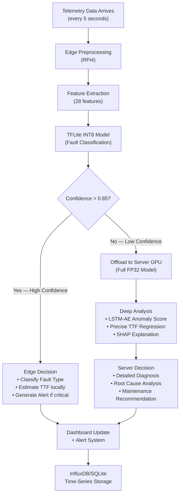
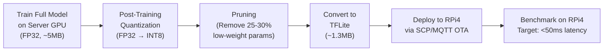

# 🖥️ Edge-AI Predictive Maintenance for Server Hardware — Complete System Design

> A B.Tech Final Year Project — CSE with AI Specialization
> Inspired by Paper 1 (EDGE-IJME 2025) and Paper 2 (Applied Sciences 2026)

> **⚠️ ARCHITECTURE CORRECTION (2026-08-02):**
> This document was originally written assuming the RTX 4060 laptop is BOTH the server being monitored AND the cloud backend. **THIS IS WRONG.**
> 
> **Corrected architecture (3 devices):**
> - 🏥 **Separate Server/Device** (TBD) = the "patient" being monitored. Runs telemetry agent. External sensors placed near it.
> - 🩺 **Raspberry Pi 4** = the "doctor" (edge). Runs TFLite models, operator dashboard, MQTT broker, WiFi hotspot.
> - 🏨 **Lenovo LOQ RTX 4060** = the "hospital" (cloud). ONLY for GPU training, deep analysis offloading, and Grafana dashboard. **Does NOT run telemetry agent. Is NOT monitored.**
> 
> The rest of this document (models, features, datasets, loss functions, etc.) remains valid — only the device-role mapping in §2 is affected. See `device_roles.md` and `MEMORIES.md` for the corrected architecture.

---

## 1. Project Vision & Problem Statement

**Problem:** Server hardware failures (CPU, GPU, HDD/SSD, PSU, RAM, cooling fans) cause unplanned downtime, data loss, and expensive emergency repairs. Traditional reactive maintenance only responds after failure. Cloud-only predictive systems suffer from latency, bandwidth costs, and single points of failure during network outages.

**Solution:** A hybrid **Edge-AI predictive maintenance system** that:
- Monitors **all major server hardware** components in real-time
- Uses **both built-in telemetry** (SMART, nvidia-smi, WMI) **and external sensors** (temperature, vibration, acoustic)
- Deploys lightweight AI models on a **Raspberry Pi 4** (edge) for instant anomaly detection
- Offloads uncertain/complex predictions to the **server (RTX 4060)** for deep analysis
- Provides **Time-to-Failure (TTF)** estimates — not just binary pass/fail
- Features a **confidence-aware hybrid architecture** (directly from Paper 2)

**What makes this an AI project:** Multi-model deep learning pipeline (1D-CNN fault classifier, LSTM-Autoencoder anomaly detector, TTF regression head), model quantization (INT8), edge-cloud inference fusion, asymmetric loss functions, and SHAP explainability.

---

## 2. System Architecture

### 2.1 High-Level Architecture Diagram

```
┌─────────────────────────────────────────────────────────────────────────────────────────────┐
│                              PHYSICAL LAYER                                                  │
│                                                                                              │
│  ┌──────────────────────────────┐          ┌─────────────────────────────────────────┐       │
│  │       SERVER (Laptop)         │          │        EDGE DEVICE (RPi4)                │       │
│  │       RTX 4060 / i7/i9        │          │        4GB/8GB RAM, ARM Cortex-A72      │       │
│  │                                │          │                                         │       │
│  │  ┌─────────────────────────┐  │          │  ┌───────────────────────────────────┐  │       │
│  │  │  Telemetry Agent        │  │  MQTT/   │  │  Edge Inference Engine            │  │       │
│  │  │  ├─ psutil (CPU/RAM)    │  │  REST    │  │  ├─ TFLite INT8 Classifier        │  │       │
│  │  │  ├─ nvidia-smi (GPU)    │──┼──────────┼──│  ├─ Lightweight TTF Estimator     │  │       │
│  │  │  ├─ pySMART (HDD/SSD)  │  │          │  │  ├─ Anomaly Detector (IsoForest)  │  │       │
│  │  │  ├─ LibreHWMon (Temps)  │  │          │  │  └─ Confidence Router             │  │       │
│  │  │  └─ WMI (PSU/Events)    │  │          │  └───────────────────────────────────┘  │       │
│  │  └─────────────────────────┘  │          │           │          │                   │       │
│  │                                │          │     confident?   uncertain?             │       │
│  │  ┌─────────────────────────┐  │          │        ▼               ▼                │       │
│  │  │  Deep Analysis Engine   │  │  ◀────── │  ┌─────────┐  ┌──────────────┐         │       │
│  │  │  ├─ Full FP32 Models    │  │ offload  │  │ Local   │  │ Offload to   │         │       │
│  │  │  ├─ LSTM-AE Anomaly     │  │          │  │ Alert   │  │ Server GPU   │         │       │
│  │  │  ├─ TTF Regression      │  │          │  └─────────┘  └──────────────┘         │       │
│  │  │  ├─ SHAP Explainer      │  │          │                                         │       │
│  │  │  └─ Model Retraining    │  │          │  ┌───────────────────────────────────┐  │       │
│  │  └─────────────────────────┘  │          │  │  EXTERNAL SENSORS (GPIO/I2C)      │  │       │
│  │                                │          │  │  ├─ DHT22 (Ambient Temp/Humidity) │  │       │
│  │  ┌─────────────────────────┐  │          │  │  ├─ ADXL345 (Vibration/Accel.)    │  │       │
│  │  │  Dashboard + Alerts     │  │          │  │  └─ MAX4466 (Acoustic/Sound)      │  │       │
│  │  │  ├─ Grafana/Web UI      │  │          │  └───────────────────────────────────┘  │       │
│  │  │  ├─ TTF Countdown       │  │          │                                         │       │
│  │  │  └─ Email/Telegram Bot  │  │          └─────────────────────────────────────────┘       │
│  │  └─────────────────────────┘  │                                                            │
│  └──────────────────────────────┘                                                            │
└─────────────────────────────────────────────────────────────────────────────────────────────┘
```

### 2.2 Confidence-Aware Hybrid Inference Flow (from Paper 2)



> [!IMPORTANT]
> This is the **key differentiator from Paper 1** — Paper 2's confidence-aware offloading. ~85-90% of predictions are handled locally on RPi4 (low latency, no network dependency). Only uncertain cases go to the server GPU for deep analysis.

---

## 3. Hardware Components & What They Monitor

### 3.1 Server Hardware Monitoring Matrix

| Component | Built-in Telemetry Source | Key Metrics | External Sensor (via RPi4) | TTF Model Type |
|-----------|--------------------------|-------------|----------------------------|----------------|
| **HDD/SSD** | pySMART → S.M.A.R.T. data | Reallocated sectors (5), Power-on hours (9), Uncorrectable errors (187), Pending sectors (197), Seek error rate (7) | ADXL345 vibration (detect bearing wear) | **XGBoost Regression** → days-to-failure |
| **CPU** | psutil + LibreHWMon | Temperature (per-core), Load %, Frequency, Throttle events, Context switches | DHT22 ambient temp (detect cooling failure) | **1D-CNN Classifier** + LSTM TTF |
| **GPU** | nvidia-smi + GPUtil | Temperature, Power draw, Memory utilization, Clock speed, ECC errors, Thermal throttle events | MAX4466 acoustic (detect fan bearing noise) | **LSTM-Autoencoder** anomaly + TTF |
| **RAM** | WMI + Windows Event Log | ECC correctable errors, Page faults, Memory pressure, Hardware events | — (software only) | **Random Forest Classifier** |
| **PSU** | LibreHWMon + WMI | Voltage rails (3.3V, 5V, 12V), Power draw, Temperature | DHT22 (PSU exhaust temp) | **Isolation Forest** anomaly detection |
| **Fans** | LibreHWMon + WMI | RPM values, Fan duty cycle | MAX4466 (acoustic signature of failing bearings) | **Anomaly Detection** (Z-score + IF) |

### 3.2 RPi4 GPIO Sensor Wiring Plan

```
                    Raspberry Pi 4 GPIO Header
                    ┌─────────────────────────┐
                    │  3.3V ── DHT22 VCC      │  Pin 1
                    │  GPIO4 ── DHT22 DATA    │  Pin 7
                    │  GND ──── DHT22 GND     │  Pin 9
                    │                         │
                    │  3.3V ── ADXL345 VCC    │  Pin 17
                    │  SDA1 ── ADXL345 SDA    │  Pin 3 (GPIO2)
                    │  SCL1 ── ADXL345 SCL    │  Pin 5 (GPIO3)
                    │  GND ──── ADXL345 GND   │  Pin 25
                    │                         │
                    │  3.3V ── MAX4466 VCC    │  Pin 17 (shared)
                    │  ADC ─── MAX4466 OUT    │  Via MCP3008 ADC
                    │  GND ──── MAX4466 GND   │  Pin 39
                    └─────────────────────────┘

    Note: RPi4 has no analog input, so MAX4466 requires
    an MCP3008 SPI ADC converter (8-channel, 10-bit)
```

> [!NOTE]
> The external sensors serve **dual purposes**: (1) they provide physical environment data that software telemetry can't capture (ambient temperature, vibration patterns, acoustic signatures), and (2) they demonstrate real IoT sensor integration for your project evaluation.

---

## 4. Datasets — What to Use & Where to Get Them

### 4.1 Primary Datasets

| Dataset | Source | Size | Purpose | Components Covered |
|---------|--------|------|---------|-------------------|
| **Backblaze Drive Stats Q1 2023** | [backblaze.com/cloud-storage/resources/hard-drive-test-data](https://www.backblaze.com/cloud-storage/resources/hard-drive-test-data) | ~2.35M rows (10 days subset) | HDD failure classification + **TTF regression** | HDD/SSD |
| **NASA C-MAPSS (FD001-FD004)** | [NASA Prognostics Data Repository](https://data.nasa.gov/dataset/C-MAPSS-Aircraft-Engine-Simulator-Data/xaut-bemq) | 26 sensors × 100+ engines | **RUL/TTF regression benchmark** — train TTF models, then transfer to server data | CPU/GPU degradation analogy |
| **AI4I 2020 Predictive Maintenance** | [UCI ML Repository](https://archive.ics.uci.edu/dataset/601/ai4i+2020+predictive+maintenance+dataset) | 10,000 rows, 14 features | Multi-failure-mode classification (heat dissipation, power, overstrain, tool wear) | CPU/PSU/General |
| **Custom Live Telemetry** | Your own server (collected by telemetry agent) | Continuous collection over 2-4 weeks | Real-world validation + model fine-tuning | ALL components |

### 4.2 How to Build the TTF (Time-to-Failure) Labels

> [!IMPORTANT]
> This is **critical** and what your professor will evaluate as the AI contribution. You specifically asked for TTF instead of binary pass/fail — here's how to construct it.

#### For Backblaze HDD Data:
```
For each drive that eventually failed (failure=1):
    1. Find the failure_date (the row where failure=1)
    2. For every earlier row of that drive:
        TTF_days = failure_date - current_date
    3. For drives that never failed during the observation period:
        TTF_days = censored (mark as "right-censored" or assign large value)

This transforms the binary classification into a regression problem:
    Input: [SMART_5, SMART_9, SMART_187, SMART_197, SMART_198, ...] 
    Output: TTF_days (continuous value, 0 = failure imminent)
```

#### For NASA C-MAPSS (Transfer Learning Base):
```
RUL labels are pre-computed in the dataset:
    RUL = max_cycle - current_cycle
    
Train LSTM-Autoencoder on this, then fine-tune on your server telemetry
```

#### For Custom Server Telemetry:
```
Since you can't wait for actual hardware failures:
    1. Simulate degradation by running stress tests + thermal throttling
    2. Use "Health Index" approach:
        HI(t) = weighted_sum(normalized_sensor_values)
        TTF_estimated = time_until(HI < critical_threshold)
    3. Inject synthetic faults (cover air vents, stress CPU, etc.)
```

### 4.3 Dataset for Each Component — Specific SMART Attributes

| Component | Dataset | Key Features for Model |
|-----------|---------|----------------------|
| **HDD** | Backblaze Q1 2023 | `smart_5_raw` (reallocated sectors), `smart_9_raw` (power-on hours), `smart_187_raw` (uncorrectable errors), `smart_188_raw` (command timeout), `smart_197_raw` (pending sectors), `smart_198_raw` (uncorrectable sector count), **Δ-features** (rate of change over 7 days) |
| **CPU** | AI4I 2020 + Custom telemetry | Temperature, load %, frequency, thermal throttle count, context switches, **thermal_ramp_rate** (°C/min), ambient-CPU delta |
| **GPU** | Custom nvidia-smi collection | Temperature, power draw, memory util, clock speed, ECC SBE count, ECC SBE rate, **thermal_ramp_rate**, fan RPM, XID error count |
| **RAM** | Custom WMI collection | Page faults/sec, committed bytes, ECC CE count, ECC CE rate, hardware error events |
| **PSU** | Custom LibreHWMon | Voltage rails (3.3V, 5V, 12V), power draw, PSU temp, **voltage_deviation** from nominal |
| **Fans** | Custom LibreHWMon | RPM, duty cycle, **RPM_deviation** from expected, acoustic RMS level |

---

## 5. AI/ML Model Architecture

### 5.1 Multi-Head Model Design

The system uses a **multi-task, multi-model architecture** — not a single monolithic model. This is both more practical and more impressive for your project:

```
┌─────────────────────────────────────────────────────────────────────────┐
│                    SERVER-SIDE MODELS (FP32, GPU)                       │
│                                                                         │
│  ┌─────────────────────────────────┐  ┌──────────────────────────────┐ │
│  │   LSTM-Autoencoder (Anomaly)    │  │   1D-CNN Multi-Task Model    │ │
│  │                                  │  │                              │ │
│  │   Encoder:                       │  │   Input: 28 features         │ │
│  │   ├─ LSTM(64) → LSTM(32)        │  │   ├─ Conv1D(32, k=3) + ReLU │ │
│  │   │   (Bottleneck: 16-dim)       │  │   ├─ Conv1D(64, k=3) + ReLU │ │
│  │   Decoder:                       │  │   ├─ MaxPool1D              │ │
│  │   ├─ LSTM(32) → LSTM(64)        │  │   ├─ Dense(128) + Dropout   │ │
│  │                                  │  │   │                          │ │
│  │   Output: Reconstruction Error   │  │   ├─ HEAD 1: Softmax(7)     │ │
│  │   If error > threshold →         │  │   │  (Fault Classification)  │ │
│  │   ANOMALY DETECTED               │  │   │                          │ │
│  │                                  │  │   └─ HEAD 2: Linear(1)      │ │
│  │   Trained on "healthy" data only │  │      (TTF Regression)        │ │
│  │   (unsupervised)                 │  │      with Asymmetric Loss    │ │
│  └─────────────────────────────────┘  └──────────────────────────────┘ │
│                                                                         │
│  ┌─────────────────────────────────┐  ┌──────────────────────────────┐ │
│  │   XGBoost (HDD Specialist)      │  │   SHAP Explainer             │ │
│  │   Trained on Backblaze SMART     │  │   Why did the model predict  │ │
│  │   Predicts: TTF_days for HDD     │  │   this? Feature importance   │ │
│  │   Features: SMART + Δ-features   │  │   for operator understanding │ │
│  └─────────────────────────────────┘  └──────────────────────────────┘ │
└─────────────────────────────────────────────────────────────────────────┘

┌─────────────────────────────────────────────────────────────────────────┐
│                    EDGE-SIDE MODELS (INT8, RPi4 CPU)                    │
│                                                                         │
│  ┌─────────────────────────────────┐  ┌──────────────────────────────┐ │
│  │   TFLite INT8 Classifier        │  │   Isolation Forest           │ │
│  │   (Quantized from 1D-CNN)       │  │   (for PSU/Fan anomaly)      │ │
│  │                                  │  │                              │ │
│  │   Input: 17 features (pruned)    │  │   Unsupervised — no failure  │ │
│  │   Output: Fault class + conf.    │  │   labels needed              │ │
│  │   + Lightweight TTF estimate     │  │   Detects: voltage drift,    │ │
│  │                                  │  │   RPM anomaly, power spikes  │ │
│  │   Size: ~1.3 MB (quantized)      │  │                              │ │
│  │   Latency: ~30-50ms on RPi4     │  │   Size: ~200 KB              │ │
│  └─────────────────────────────────┘  └──────────────────────────────┘ │
└─────────────────────────────────────────────────────────────────────────┘
```

### 5.2 Model Details — The 7 Fault Classes

| Class | Label | Description | Primary Sensors |
|-------|-------|-------------|----------------|
| 0 | `HEALTHY` | All systems nominal | All |
| 1 | `HDD_DEGRADATION` | SMART values deteriorating | SMART attributes |
| 2 | `THERMAL_CRITICAL` | CPU/GPU overheating, throttling | Temperature sensors |
| 3 | `PSU_ANOMALY` | Voltage rail deviation, power instability | LibreHWMon voltages |
| 4 | `FAN_FAILURE` | Fan RPM drop, acoustic anomaly | RPM + acoustic sensor |
| 5 | `MEMORY_FAULT` | ECC errors increasing | WMI events |
| 6 | `GPU_DEGRADATION` | ECC errors, clock drops, thermal runaway | nvidia-smi |

### 5.3 Asymmetric Loss Function for TTF (from Paper 2)

```python
# The key insight: OVERESTIMATING remaining life is DANGEROUS
# (you think you have 30 days but it fails in 5 days = catastrophe)
# UNDERESTIMATING is cautious and safe
# (you think you have 5 days but it would last 30 = early replacement, minor cost)

def asymmetric_ttf_loss(y_pred, y_true, alpha=2.0):
    """
    alpha > 1 penalizes overestimation more heavily
    """
    error = y_pred - y_true
    loss = torch.where(
        error > 0,                           # overestimation
        alpha * (error ** 2),                 # heavy penalty
        error ** 2                            # normal penalty
    )
    # Extra weight for imminent failures (TTF < 20% of max)
    weights = torch.where(y_true < 0.2, 3.0, 1.0)
    return (loss * weights).mean()
```

> [!TIP]
> This asymmetric loss is **your strongest AI contribution**. It's directly from Paper 2 and shows sophisticated understanding of real-world maintenance constraints. Your professor will appreciate the engineering judgment behind this.

### 5.4 Training Strategy

| Model | Training Data | Training Location | Optimization |
|-------|--------------|-------------------|-------------|
| 1D-CNN Classifier | AI4I 2020 + Custom telemetry | Server GPU (RTX 4060) | Train FP32 → Quantize to INT8 → Export TFLite |
| LSTM-Autoencoder | Custom "healthy" telemetry (2+ weeks) | Server GPU | Unsupervised, no labels needed |
| XGBoost HDD TTF | Backblaze Q1 2023 (with TTF labels) | Server GPU (`tree_method='hist', device='cuda'`) | Direct deploy (sklearn compatible) |
| TTF Regression Head | NASA C-MAPSS (pretrain) → Fine-tune on custom | Server GPU | Transfer learning approach |
| Isolation Forest | Custom PSU/Fan telemetry | Server CPU or RPi4 CPU | Lightweight, scikit-learn |

---

## 6. Data Collection Pipeline — How the Telemetry Agent Works

### 6.1 Server-Side Telemetry Agent (runs on your laptop)

```
┌─────────────────────────────────────────────────────────────────┐
│                  TELEMETRY COLLECTOR SERVICE                     │
│                  (Python daemon on server)                       │
│                                                                  │
│  Every 5 seconds:                                                │
│  ┌─────────────┐  ┌──────────────┐  ┌────────────────────────┐  │
│  │   psutil     │  │  nvidia-smi   │  │  LibreHardwareMonitor  │  │
│  │  ├ CPU temp  │  │  ├ GPU temp   │  │  ├ Motherboard temps   │  │
│  │  ├ CPU load  │  │  ├ GPU power  │  │  ├ Voltage rails       │  │
│  │  ├ CPU freq  │  │  ├ GPU mem %  │  │  ├ Fan RPMs            │  │
│  │  ├ RAM used  │  │  ├ GPU clock  │  │  └ PSU sensors         │  │
│  │  ├ Disk I/O  │  │  └ ECC errors │  │                        │  │
│  │  └ Net I/O   │  └──────────────┘  └────────────────────────┘  │
│  └─────────────┘                                                  │
│         │                  │                     │                │
│         └──────────────────┴─────────────────────┘                │
│                           │                                       │
│                    ┌──────▼──────┐                                │
│                    │  Unified    │                                │
│                    │  JSON       │    Every 60 seconds:           │
│                    │  Payload    │──→ pySMART SMART dump          │
│                    └──────┬──────┘                                │
│                           │                                       │
│                    ┌──────▼──────┐                                │
│                    │   MQTT      │                                │
│                    │  Publish    │──→ Topic: server/telemetry     │
│                    │  + Local DB │──→ InfluxDB / SQLite           │
│                    └─────────────┘                                │
└─────────────────────────────────────────────────────────────────┘
```

### 6.2 What Gets Collected (Full Feature List — 45+ raw features)

```json
{
  "timestamp": "2026-08-01T23:15:00Z",
  "cpu": {
    "temp_package": 72.0,
    "temp_cores": [70, 71, 73, 72, 71, 70],
    "load_percent": 65.2,
    "frequency_mhz": 4200,
    "throttle_count": 0,
    "context_switches": 15234
  },
  "gpu": {
    "temp": 68.0,
    "power_draw_w": 85.5,
    "memory_used_mb": 3200,
    "memory_total_mb": 8192,
    "clock_mhz": 2100,
    "fan_rpm": 1800,
    "ecc_sbe_count": 0,
    "utilization_percent": 45
  },
  "ram": {
    "used_gb": 12.4,
    "total_gb": 16.0,
    "page_faults_sec": 120,
    "committed_gb": 14.2
  },
  "hdd": {
    "smart_5_raw": 0,
    "smart_9_raw": 8760,
    "smart_187_raw": 0,
    "smart_188_raw": 0,
    "smart_197_raw": 0,
    "smart_198_raw": 0,
    "smart_194_raw": 35,
    "read_error_rate": 0,
    "temperature": 35
  },
  "psu": {
    "voltage_3v3": 3.312,
    "voltage_5v": 5.021,
    "voltage_12v": 12.045,
    "power_draw_w": 180.5
  },
  "fans": {
    "cpu_fan_rpm": 1200,
    "case_fan1_rpm": 900,
    "case_fan2_rpm": 920
  },
  "environment": {
    "ambient_temp": 28.5,
    "humidity": 55.2,
    "vibration_rms": 0.12,
    "acoustic_rms": 0.08
  }
}
```

### 6.3 RPi4-Side Sensor Collection (via GPIO)

The RPi4 collects from its **physically connected sensors** and combines them with data received from the server telemetry agent:

```
RPi4 Local Sensors (GPIO/I2C/SPI):
├── DHT22 → ambient_temp, humidity (every 2 seconds)
├── ADXL345 → vibration_x, vibration_y, vibration_z (every 100ms, then RMS computed)
└── MAX4466 via MCP3008 → acoustic_level (every 100ms, then RMS + FFT)

Server Telemetry (received via MQTT):
├── All software telemetry from Section 6.2
└── Arrives every 5 seconds

FUSION → Combined feature vector (28-45 features) → Model input
```

---

## 7. Feature Engineering (The AI Part — 28 Engineered Features)

> [!IMPORTANT]
> Raw sensor values aren't enough. The **rate of change** (Δ-features) and **cross-sensor correlations** are far more predictive than snapshots. This is a critical AI/ML engineering step.

### 7.1 Engineered Features (inspired by Paper 2)

| # | Feature Name | Formula / Description | Why It Matters |
|---|-------------|----------------------|----------------|
| 1 | `cpu_temp` | Raw CPU package temperature | Baseline thermal state |
| 2 | `cpu_load` | Raw CPU load % | Workload context |
| 3 | `cpu_thermal_ramp` | `(temp[t] - temp[t-5]) / 5` (°C/sec) | **Cooling system health** — rising ramp = failing cooling |
| 4 | `cpu_ambient_delta` | `cpu_temp - ambient_temp` | Contextual: 80°C in 20°C room ≠ 80°C in 35°C room |
| 5 | `gpu_temp` | Raw GPU temperature | Baseline |
| 6 | `gpu_power_draw` | Raw power in watts | Workload context |
| 7 | `gpu_thermal_ramp` | Same as CPU version | GPU cooling degradation |
| 8 | `gpu_power_efficiency` | `gpu_utilization / gpu_power_draw` | Declining efficiency = degradation |
| 9 | `gpu_ecc_rate` | `ecc_errors / time_window` | **Most predictive GPU feature** — rate matters more than count |
| 10 | `hdd_smart5_delta_7d` | Rate of change of reallocated sectors over 7 days | Accelerating sector failures |
| 11 | `hdd_smart187_delta_7d` | Rate of change of uncorrectable errors | Error acceleration |
| 12 | `hdd_smart197_current` | Current pending sectors (raw) | Immediate risk indicator |
| 13 | `hdd_health_index` | Weighted composite of SMART 5,187,188,197,198 | Single health score for HDD |
| 14 | `psu_voltage_3v3_dev` | `abs(voltage_3v3 - 3.3) / 3.3 × 100` | % deviation from nominal — should be <5% |
| 15 | `psu_voltage_12v_dev` | Same for 12V rail | 12V rail powers CPU/GPU — critical |
| 16 | `psu_voltage_stability` | `std(voltage_12v, window=60s)` | High variance = capacitor aging |
| 17 | `fan_rpm_deviation` | `(actual_rpm - expected_rpm) / expected_rpm` | Bearing wear detection |
| 18 | `fan_acoustic_rms` | RMS of acoustic sensor signal | Abnormal noise = mechanical failure |
| 19 | `fan_acoustic_kurtosis` | Kurtosis of acoustic FFT | Impulsive noise pattern = bearing defect |
| 20 | `ram_page_fault_rate` | Page faults per second | Memory pressure indicator |
| 21 | `ram_ecc_rate` | ECC correctable error rate | Memory cell degradation |
| 22 | `vibration_rms` | `sqrt(x² + y² + z²)` from ADXL345 | General mechanical health |
| 23 | `vibration_kurtosis` | Kurtosis of vibration signal | Detects impulsive faults |
| 24 | `vibration_peak_freq` | Dominant frequency from FFT | Bearing fault frequency signature |
| 25 | `ambient_temp` | From DHT22 | Environmental context |
| 26 | `humidity` | From DHT22 | Corrosion risk |
| 27 | `system_uptime_hours` | Total hours since last reboot | Aging/fatigue factor |
| 28 | `overall_health_index` | Weighted fusion of all component health scores | Single-number system health |

---

## 8. RPi4 Role — Edge Deployment Strategy

### 8.1 Why RPi4 (not just software on the server)?

| Reason | Explanation |
|--------|-------------|
| **Independent watchdog** | If the server crashes, the RPi4 still monitors it and can alert you |
| **External sensor integration** | GPIO/I2C/SPI for physical sensors — server doesn't have this |
| **Edge AI demonstration** | Shows model optimization (quantization, pruning) — core to your AI curriculum |
| **Low power, always-on** | RPi4 draws ~5W vs. server's 150W+ — can monitor 24/7 |
| **Paper alignment** | Both Paper 1 and Paper 2 use edge devices — this is your project's domain |

### 8.2 RPi4 Software Stack

```
Raspberry Pi 4 (Raspbian OS)
├── sensor_collector.py        # Reads DHT22, ADXL345, MAX4466
├── mqtt_subscriber.py         # Receives server telemetry via MQTT
├── feature_engine.py          # Computes 28 engineered features
├── edge_inference.py          # Runs TFLite INT8 model + Isolation Forest
├── confidence_router.py       # Decides: local decision vs. offload to server
├── alert_manager.py           # Sends alerts (email/Telegram/buzzer)
├── api_server.py              # FastAPI on port 8080 (dashboard backend)
└── models/
    ├── classifier_int8.tflite # Quantized fault classifier (~1.3 MB)
    ├── ttf_lite.tflite        # Lightweight TTF estimator
    └── iso_forest.pkl         # Isolation Forest for PSU/Fan anomaly
```

### 8.3 Model Optimization Pipeline (Server → Edge)



---

## 9. Communication Architecture

### 9.1 MQTT Topic Structure

```
server/
├── telemetry/          # Server → RPi4 (every 5s): full sensor JSON
├── smart/              # Server → RPi4 (every 60s): SMART dump
├── alerts/             # RPi4 → Server: fault alerts
├── predictions/        # RPi4 → Server: edge predictions with confidence
├── offload/request/    # RPi4 → Server: uncertain cases for deep analysis
├── offload/response/   # Server → RPi4: deep analysis results
└── model/update/       # Server → RPi4: OTA model updates
```

### 9.2 Data Flow Timing

| Event | Frequency | Direction | Payload Size |
|-------|-----------|-----------|-------------|
| Software telemetry | Every 5 seconds | Server → RPi4 | ~1 KB JSON |
| SMART data | Every 60 seconds | Server → RPi4 | ~2 KB JSON |
| Edge prediction | Every 5 seconds | RPi4 (local) | — |
| Offload request | ~10-15% of predictions | RPi4 → Server | ~500 B |
| Deep analysis response | Per offload request | Server → RPi4 | ~2 KB |
| Model update (OTA) | Weekly / on-demand | Server → RPi4 | ~1.3 MB |

---

## 10. Dashboard & Visualization

### 10.1 Dashboard Components

The dashboard will be served by the RPi4's FastAPI backend and accessible from any browser:

| Panel | Content | Update Frequency |
|-------|---------|-----------------|
| **System Health Overview** | Overall health index (0-100%) with color gradient | Every 5s |
| **Component Cards** | Per-component health (CPU, GPU, HDD, PSU, RAM, Fans) with mini TTF countdown | Every 5s |
| **TTF Timeline** | Time-to-failure estimates for each component, displayed as countdown bars | Every 30s |
| **Anomaly Log** | Scrolling list of detected anomalies with timestamps and severity | On event |
| **Sensor Trends** | Line charts of key metrics (temperature, voltage, RPM) over time | Every 5s |
| **SHAP Explanations** | When server deep analysis runs: "Why was this flagged?" with feature importance | On offload |
| **Alert History** | Historical record of all alerts and maintenance actions | On event |

### 10.2 Alert Levels

| Level | Condition | Action |
|-------|-----------|--------|
| 🟢 **HEALTHY** | All TTF > 30 days, no anomalies | Log only |
| 🟡 **WARNING** | Any TTF < 30 days OR anomaly score > 0.6 | Dashboard highlight + email |
| 🟠 **CRITICAL** | Any TTF < 7 days OR anomaly score > 0.8 | Buzzer + Telegram + email |
| 🔴 **EMERGENCY** | Any TTF < 24 hours OR system instability detected | Audible alarm + SMS + auto-log |

---

## 11. Project Directory Structure

```
Predictive maintenance for Server/
├── MEMORIES.md
├── PROJECT_SUMMARY.md
├── README.md
│
├── docs/
│   ├── architecture_diagram.png
│   ├── system_design.md
│   └── evaluation_results.md
│
├── server/                          # Runs on your laptop (RTX 4060)
│   ├── telemetry_agent/
│   │   ├── collector.py             # psutil + nvidia-smi + LibreHWMon + pySMART
│   │   ├── mqtt_publisher.py        # Publishes telemetry to MQTT broker
│   │   └── smart_reader.py          # SMART data extraction
│   │
│   ├── training/
│   │   ├── train_classifier.py      # 1D-CNN multi-task model (fault + TTF)
│   │   ├── train_lstm_ae.py         # LSTM-Autoencoder anomaly detector
│   │   ├── train_xgboost_hdd.py     # XGBoost TTF for HDD (Backblaze)
│   │   ├── train_iso_forest.py      # Isolation Forest for PSU/Fan
│   │   ├── feature_engineering.py   # Compute Δ-features, rolling stats
│   │   ├── data_loader.py           # Load Backblaze, NASA, AI4I, custom
│   │   └── asymmetric_loss.py       # Custom loss function (Paper 2)
│   │
│   ├── deep_analysis/
│   │   ├── inference_server.py      # FastAPI on server for deep predictions
│   │   ├── shap_explainer.py        # SHAP feature importance
│   │   └── ttf_regression.py        # Full-precision TTF estimation
│   │
│   ├── optimization/
│   │   ├── quantize_model.py        # FP32 → INT8 conversion
│   │   ├── prune_model.py           # Weight pruning
│   │   └── export_tflite.py         # Export to TFLite for RPi4
│   │
│   └── models/                      # Trained model artifacts
│       ├── classifier_fp32.h5
│       ├── classifier_int8.tflite
│       ├── lstm_ae.h5
│       ├── xgboost_hdd.pkl
│       └── iso_forest.pkl
│
├── edge/                            # Runs on Raspberry Pi 4
│   ├── sensor_collector.py          # GPIO: DHT22, ADXL345, MAX4466
│   ├── mqtt_handler.py              # Subscribe server telemetry + publish alerts
│   ├── feature_engine.py            # Real-time feature computation
│   ├── edge_inference.py            # TFLite inference + Isolation Forest
│   ├── confidence_router.py         # Offload logic (confidence < 0.85 → server)
│   ├── ttf_estimator.py             # Lightweight TTF computation
│   ├── alert_manager.py             # Email/Telegram/buzzer alerts
│   ├── api_server.py                # FastAPI dashboard backend
│   └── models/                      # Edge model artifacts
│       ├── classifier_int8.tflite
│       ├── ttf_lite.tflite
│       └── iso_forest.pkl
│
├── dashboard/                       # Web dashboard (HTML/CSS/JS)
│   ├── index.html
│   ├── style.css
│   ├── app.js
│   └── assets/
│
├── data/
│   ├── backblaze/                   # Backblaze SMART CSVs
│   ├── nasa_cmapss/                 # NASA C-MAPSS for TTF pretraining
│   ├── ai4i_2020/                   # AI4I synthetic maintenance data
│   ├── custom_telemetry/            # Your collected server telemetry
│   └── processed/                   # Preprocessed + feature-engineered data
│
├── notebooks/                       # Jupyter notebooks for EDA & experiments
│   ├── 01_eda_backblaze.ipynb
│   ├── 02_eda_custom_telemetry.ipynb
│   ├── 03_model_comparison.ipynb
│   ├── 04_ttf_analysis.ipynb
│   └── 05_edge_benchmarks.ipynb
│
├── tests/
│   ├── test_telemetry_agent.py
│   ├── test_feature_engine.py
│   ├── test_edge_inference.py
│   └── test_mqtt_pipeline.py
│
├── requirements_server.txt
├── requirements_edge.txt
└── docker-compose.yml               # Optional: MQTT broker + InfluxDB
```

---

## 12. Implementation Phases & Timeline

### Phase 0: Setup & Data Collection (Week 1-2)
- [ ] Set up MQTT broker (Mosquitto) on RPi4 or server
- [ ] Build telemetry agent on server (psutil, nvidia-smi, LibreHWMon, pySMART)
- [ ] Wire external sensors to RPi4 (DHT22, ADXL345, MAX4466)
- [ ] Start collecting telemetry data continuously (need 2+ weeks of "healthy" data)
- [ ] Download Backblaze Q1 2023, NASA C-MAPSS, AI4I 2020 datasets

### Phase 1: Data Preparation & Feature Engineering (Week 2-3)
- [ ] Build TTF labels for Backblaze data
- [ ] Implement feature engineering pipeline (28 features)
- [ ] EDA notebooks for each dataset
- [ ] Preprocessing: normalization, denoising, segmentation
- [ ] Handle class imbalance (SMOTE / class weighting)

### Phase 2: Model Training (Week 3-5)
- [ ] Train 1D-CNN multi-task model (classifier + TTF head) on server GPU
- [ ] Train LSTM-Autoencoder on "healthy" telemetry
- [ ] Train XGBoost HDD TTF model on Backblaze
- [ ] Train Isolation Forest on PSU/Fan data
- [ ] Cross-validate and select best hyperparameters
- [ ] Implement asymmetric loss function for TTF

### Phase 3: Edge Optimization & Deployment (Week 5-6)
- [ ] Quantize 1D-CNN to INT8 TFLite
- [ ] Prune model weights
- [ ] Benchmark on RPi4 (target: <50ms latency)
- [ ] Deploy edge models to RPi4
- [ ] Implement confidence-aware routing

### Phase 4: System Integration (Week 6-7)
- [ ] End-to-end MQTT pipeline: server → RPi4 → prediction → alert
- [ ] Implement offloading logic (uncertain cases → server GPU)
- [ ] Build dashboard (web UI)
- [ ] Set up alert system (email/Telegram)
- [ ] Implement SHAP explainability on server side

### Phase 5: Evaluation & Documentation (Week 7-8)
- [ ] Evaluate classification accuracy, precision, recall, F1
- [ ] Evaluate TTF regression (MAE, RMSE)
- [ ] Compare edge vs. server accuracy and latency
- [ ] Bandwidth reduction measurement
- [ ] Write project report
- [ ] Prepare demo

---

## 13. Expected Results (Target Metrics)

| Metric | Target | Paper 1 Baseline | Paper 2 Baseline |
|--------|--------|-------------------|-------------------|
| Fault Classification Accuracy (Server FP32) | > 95% | 97.6% (cloud) | 97.3% |
| Fault Classification Accuracy (Edge INT8) | > 92% | 94.7% (edge) | ~93% |
| TTF MAE (Server) | < 0.05 normalized | N/A | 0.0332 |
| TTF MAE (Edge) | < 0.08 normalized | N/A | 0.0451 |
| Edge Inference Latency | < 50 ms | 30 ms | 42.3 ms |
| Server Inference Latency | < 200 ms | 350 ms | ~90 ms |
| Bandwidth Reduction (edge vs cloud-only) | > 70% | 71-72% | ~85-92% |
| Model Size (Edge) | < 2 MB | 1.3 MB | ~1 MB |

---

## 14. Bill of Materials (Hardware)

| Item | Quantity | Estimated Cost (INR) | Purpose |
|------|----------|---------------------|---------|
| Raspberry Pi 4 (4GB) | 1 | Already owned | Edge compute device |
| Laptop with RTX 4060 | 1 | Already owned | Server / GPU training |
| DHT22 Sensor | 1 | ₹150-200 | Ambient temperature + humidity |
| ADXL345 Accelerometer | 1 | ₹200-350 | Vibration detection |
| MAX4466 Electret Mic | 1 | ₹150-250 | Acoustic monitoring |
| MCP3008 ADC (SPI) | 1 | ₹100-150 | Analog-to-digital for MAX4466 |
| Jumper wires + Breadboard | 1 set | ₹100-200 | Wiring |
| MicroSD 32GB (RPi4) | 1 | ₹300-400 | RPi4 storage |
| **Total Additional** | | **₹1000-1550** | |

---

## User Review Required

> [!IMPORTANT]
> **Network Setup:** The RPi4 and your laptop need to be on the same local network (WiFi/Ethernet) for MQTT communication. Is your home/lab network setup suitable for this? Do you have a router where both devices can connect?

> [!IMPORTANT]
> **RPi4 Model:** Do you have a 4GB or 8GB RPi4? The 8GB model gives more headroom for running the TFLite models alongside the sensor collection and API server.

> [!WARNING]
> **External Sensors:** The ADXL345 and MAX4466 need to be physically mounted near the server hardware to detect vibration and acoustic anomalies. For the demo, you can place the RPi4 near/on top of the laptop. If purchasing sensors is an issue, the system can work with software-only telemetry (reduced feature set, ~20 features instead of 28).

## Open Questions

> [!IMPORTANT]
> 1. **Do you already have the external sensors (DHT22, ADXL345, MAX4466)?** If not, should we design a software-only version first and add sensors later?
> 2. **What OS is on your RPi4?** Raspbian/Raspberry Pi OS? This affects the sensor library choices.
> 3. **Do you want the dashboard on the RPi4 or the laptop?** RPi4 makes it a true "edge dashboard" but the laptop gives a richer UI experience.
> 4. **Timeline:** How many weeks do you have before submission? This affects which phases to prioritize.
> 5. **Do you want a Grafana-based dashboard (easier, professional look) or a custom HTML/JS dashboard (more code to show, more "your own work")?**

## Verification Plan

### Automated Tests
- Unit tests for feature engineering pipeline
- Integration test: telemetry → MQTT → edge inference → alert
- Model accuracy benchmarks (comparison table: edge vs. server)
- Latency benchmarks on RPi4

### Manual Verification
- Run stress tests on server (Prime95 for CPU, FurMark for GPU) to validate thermal predictions
- Simulate HDD degradation by feeding historical Backblaze failure sequences
- Verify TTF countdown accuracy against known degradation patterns
- Demo the full pipeline: data collection → edge prediction → server offload → dashboard → alert
